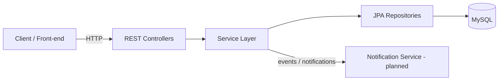

# Architecture
## Health Camp Registration and Deployment Platform

> **Status:** Planned. The skeleton in this repository currently contains only the Spring Boot main class. The layers and components below describe the intended design.

## 1. Overview
A classic layered Spring Boot service exposing a REST API, backed by MySQL, with H2 used for automated tests.

## 2. Logical layers
1. **Presentation / Web layer** — REST controllers (`@RestController`) and DTOs. Handles HTTP, request validation, and response mapping.
2. **Service layer** — Business logic for registration, approval, and listing. Transactional boundaries live here.
3. **Persistence layer** — Spring Data JPA repositories; entities map to MySQL tables.
4. **Cross-cutting** — Configuration, validation, exception handling, logging.

## 3. Component diagram (planned)

## 4. Request flow (planned)
- **Registration:** Client -> POST registration -> Controller validates -> Service checks duplicates and capacity -> Repository saves a `PENDING` registration.
- **Approval:** Organizer -> PATCH status -> Service transitions `PENDING` -> `APPROVED`/`REJECTED` -> Repository updates -> Notification (planned).
- **Listing:** Organizer -> GET list with filters -> Service queries the Repository -> Controller returns paged results.

## 5. Technology choices
- Spring Boot 3.5.x, Java 17, Spring Web, Spring Data JPA.
- MySQL 8.x (production), H2 (tests, MySQL compatibility mode).
- Maven build; JUnit 5 tests.
- Bean Validation (`spring-boot-starter-validation`, to be added when implementing FR-1).

## 6. Deployment architecture (planned)
- Runnable JAR deployed in a container.
- Environment variables supply database and server configuration.
- A reverse proxy (e.g. nginx) terminates TLS and forwards to the app container.
- See `docs/deployment.md` for details.

## 7. Security (planned)
- Input validation on all endpoints.
- Secrets only via environment variables or a secrets manager.
- Authentication and authorization (organizer vs participant roles) are a planned follow-up.
