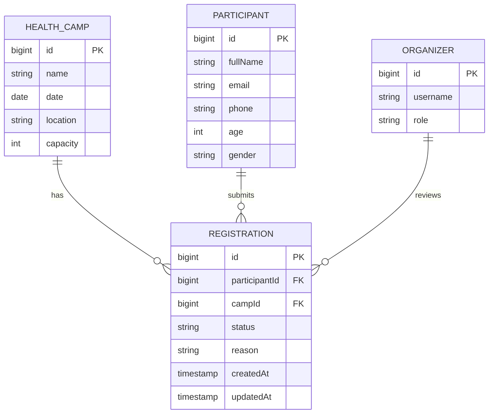
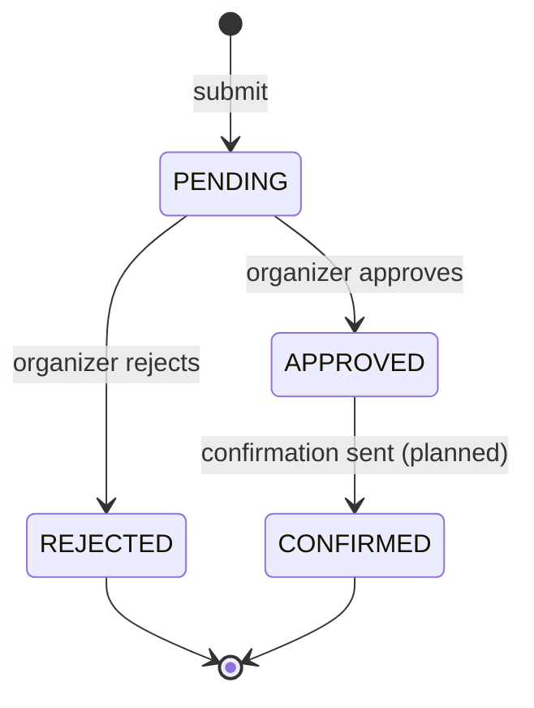

# Data Model
## Health Camp Registration and Deployment Platform

> **Status:** Planned. No JPA entities exist yet; this describes the intended model for the MVP.

## 1. Entities

### HealthCamp
| Field | Type | Notes |
| --- | --- | --- |
| id | BIGINT (PK) | Auto-generated. |
| name | VARCHAR(255) | Required. |
| date | DATE | Scheduled date. |
| location | VARCHAR(255) | Required. |
| capacity | INT | Maximum participants. |

### Participant
| Field | Type | Notes |
| --- | --- | --- |
| id | BIGINT (PK) | Auto-generated. |
| fullName | VARCHAR(255) | Required. |
| email | VARCHAR(255) | Required. |
| phone | VARCHAR(32) | Required, validated. |
| age | INT | Optional. |
| gender | VARCHAR(16) | Optional. |

### Registration
| Field | Type | Notes |
| --- | --- | --- |
| id | BIGINT (PK) | Auto-generated. |
| participantId | BIGINT (FK) | References Participant. |
| campId | BIGINT (FK) | References HealthCamp. |
| status | VARCHAR(16) | PENDING, APPROVED, REJECTED, CONFIRMED. |
| reason | VARCHAR(500) | Optional rejection reason. |
| createdAt | TIMESTAMP | Audit. |
| updatedAt | TIMESTAMP | Audit. |

Unique constraint: `(participantId, campId)` — one registration per participant per camp.

### Organizer (planned)
| Field | Type | Notes |
| --- | --- | --- |
| id | BIGINT (PK) | Auto-generated. |
| username | VARCHAR(255) | Unique. |
| role | VARCHAR(32) | ORGANIZER / ADMIN (planned). |

## 2. Relationships
- A HealthCamp has many Registrations.
- A Participant has many Registrations.
- A Registration belongs to one Participant and one HealthCamp.
- An Organizer approves Registrations.

## 3. ER diagram (planned)

## 4. Status lifecycle (planned)

